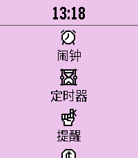

# Mica（云母）

**Your AI. Your keys. Your wrist.**

Mica is a bring-your-own-API AI assistant for modern Pebble watches — no Mica server and no subscription.

Bobby 体验 + Billy 的免订阅 + pebble-ai-companion 的多 provider，三合一的 Pebble AI 助手。面向 **Pebble Time 2（emery）** 与 **Pebble Round 2（gabbro）**。

> **当前版本 v0.3.2**（[GitHub 预发布](https://github.com/rickyxu83/mica-pebble/releases/tag/v0.3.2)）：已在 Pebble Time 2 真机上日常使用，中文 UI 内置；尚未上架 Pebble 应用商店。

<p>
  
  
</p>

- **BYOA（Bring Your Own API）**：自带 API key，手机端 PKJS 直连 LLM 厂商，**零自建服务器、零 Rebble 订阅**，key 只存在手机本地
- **OpenAI 兼容任意端点**：OpenAI / DeepSeek / Kimi / Qwen / OpenRouter / 本地 Ollama / LM Studio，只要兼容 `/v1/chat/completions` 即可
- **多 provider**：Google Gemini（含联网搜索 grounding）、OpenAI 兼容、Anthropic Claude，设置页一键切换，key/model/endpoint 分别保存
- **语音输入**：走 Pebble 官方 Dictation API；新 Core 手机 App 在手机本地转写（系统语音识别或本地 Whisper），**语音也免费**
- **Bobby 系完整体验**：闹钟 / 定时器 / Timeline 提醒 / 天气卡片 / 地图卡片 / 澄清选项 / 图片传输 / 个人记忆 / Quick Launch
- **表情脸吉祥物**：声波柱图标回到主页会变形为胶囊眼 + ω 嘴的表情脸，待机时轮换 9 种表情；思考状态也是它
- **动画与触摸**：窗口弹性进出场、内容滑入、主页呼吸动效；Time 2 / Round 2 支持手势导航与手指跟随滚动
- **主题配色**：薰衣草（默认）/ 天蓝 / 薄荷 / 蜜瓜四种主题色，设置页切换
- **听写自动续录**：语音输入被手机通知打断后，回到 Mica 自动重新开始听写（被打断的那一句需重说，平台限制）
- **诊断与反馈**：设置页内置诊断日志；语音反馈默认打开本仓库 Issues，不会静默丢失

## 灵感来源

Mica 的产品设计和工程实现受到以下三个开源项目的直接启发，感谢原作者与 Pebble / Rebble 社区：

| 项目 | 对 Mica 的启发 |
|---|---|
| [**Bobby / Tiny Assistant**](https://github.com/pebble-dev/bobby-assistant) | Pebble 原生助手体验、对话与卡片设计，以及闹钟、定时器、提醒等腕上交互方式 |
| [**Billy**](https://github.com/TomBolger/Billy) | 免订阅、用户自带 API key、无自建服务器的方向；也是 Mica 的直接代码底座 |
| [**pebble-ai-companion**](https://github.com/Toyontaker/pebble-ai-companion) | 多 LLM Provider 的产品思路、emery / gabbro 双平台支持和圆屏适配参考 |

Mica 在此基础上重点发展 **多 Provider、自定义 OpenAI-compatible Endpoint、BYOA 和零 Mica 服务器**。Mica 是修改后的独立 fork，不是上述项目或其作者的官方版本，也不暗示其背书。详细版权与修改声明见 [NOTICE](NOTICE) 和 [THIRD_PARTY_NOTICES.md](THIRD_PARTY_NOTICES.md)。

## 支持状态

| 平台 / 功能 | 当前状态 |
|---|---|
| Pebble Time 2（emery）构建与 PBW 打包 | ✅ 已通过 |
| emery 模拟器安装、首次启动、主界面与菜单 | ✅ 已通过 |
| emery 真机、语音与 DeepSeek 实测 | ✅ 已通过（真机日常使用） |
| 表情脸、界面动画与触摸手势 | ✅ 已通过 |
| Pebble Round 2（gabbro）构建、打包与圆屏模拟器 | ✅ 已通过 |
| 中文 UI、内置中文字体与中英文切换 | ✅ 已通过 |
| Provider 模板与高级项折叠设置页 | ✅ 已优化 |
| Android companion | 可选上游运行时，Mica 独立品牌适配尚未开始 |

## 下载

最新预编译版见 **[GitHub Releases](https://github.com/rickyxu83/mica-pebble/releases/tag/v0.3.2)**（v0.3.2，含 emery / gabbro）。下载 PBW 后可通过 Pebble 手机 App 或 `pebble install` 侧载安装。

## 快速开始

### 环境要求

- Linux 或 macOS
- Python 3.13（当前 `pebble-tool` 不支持 Python 3.14）
- Node.js
- [`uv`](https://docs.astral.sh/uv/) 与 Pebble SDK

### 安装 Pebble 工具链

首次准备工具链（Python 3.13）：

```bash
uv tool install pebble-tool --python 3.13
pebble sdk install latest
```

### 测试、构建与模拟器安装

```bash
git clone https://github.com/rickyxu83/mica-pebble.git
cd mica-pebble

for test in test/test_*.js; do
  node "$test"
done

cd app
pebble build                         # 输出 app/build/app.pbw
pebble install --emulator emery
```

`CMakeLists.clion.txt` 只供 IDE 索引，不是实际构建入口；构建使用 `wscript`。

真机到手后，在手机 Pebble App 开启 Developer Connection，然后运行：

```bash
cd app
pebble install --phone <手机IP>
```

## 配置 AI Provider

在 Pebble 手机 App 的 Mica 设置页中选择 Provider。API key 保存在手机本地，请求由手机直接发往所选服务，不经过 Mica 服务器。

| Provider | Base URL 示例 | Model 示例 |
|---|---|---|
| Google Gemini | 内置，无需填写 | `gemini-3.1-flash-lite` |
| OpenAI | 留空使用官方端点 | `gpt-4o-mini` |
| DeepSeek | `https://api.deepseek.com/v1` | `deepseek-chat` |
| Kimi | `https://api.moonshot.cn/v1` | `moonshot-v1-8k` |
| Qwen | `https://dashscope.aliyuncs.com/compatible-mode/v1` | `qwen-plus` |
| Ollama | `http://<电脑IP>:11434/v1` | `llama3.1` |
| Anthropic Claude | 内置，无需填写 | `claude-sonnet-4-5` |

OpenAI-compatible 使用 `/v1/chat/completions`。设置页默认只显示服务商和 Key：选择 DeepSeek、Kimi、Qwen、OpenRouter、Ollama 等模板会自动填入地址和推荐模型；高级端点、模型、Runtime 和反馈项默认折叠。各家 key、model 和 endpoint 分别保存，切换 Provider 不用重填。Key 输入使用密码框。自定义公网 Endpoint 需要 Internet 权限；Ollama / LM Studio 等局域网服务需要 LocalNetwork 权限。

> 不要把 API key 提交到仓库。公网自定义 Endpoint 建议只使用 HTTPS；纯 HTTP 仅限可信局域网。

语音使用系统 Dictation，需手机蓝牙和网络。若手机停用 Usage logs / 语音数据，手表会显示明确提示；未连接、未听到声音或转写失败也有独立错误说明，并可返回使用示例问题。

## 目录结构

```text
app/                 Pebble C UI、PKJS、设置页与资源
test/                不调用真实付费 API 的 Node 测试
docs/                合规审查与模拟器截图
reference/           本地上游浅克隆（已忽略，不提交）
LICENSE              Mica 与上游 Apache 2.0 正文
NOTICE               fork 来源与修改声明
PRIVACY.md           隐私政策
THIRD_PARTY_NOTICES.md 第三方版权与数据服务署名
```

## 贡献

欢迎 Issue 和 PR。提交前请运行全部 `test/test_*.js` 与 `pebble build`。项目沿用 DCO，请使用 `git commit -s` 添加与 Git 作者邮箱匹配的 `Signed-off-by`，详见 [CONTRIBUTING.md](CONTRIBUTING.md)。

## 合规与隐私

- [第三方参考项目法律风险审查](docs/LEGAL_REVIEW.md)
- [第三方版权与许可证](THIRD_PARTY_NOTICES.md)
- [隐私政策](PRIVACY.md)

三个参考项目的许可证允许修改与再发布，但公开上架前仍需完成审查文档中的
商业天气 API、美术权属、名称商标和商店隐私检查。完整开源许可证已作为
raw resources 打入 PBW。

## 致谢与许可

Apache 2.0。基于 [Billy](https://github.com/TomBolger/Billy)（Thomas Bolger）fork，
上游为 [Bobby](https://github.com/pebble-dev/bobby-assistant) / Tiny Assistant（Rebble & Pebble 社区，Katharine Berry）。
多 provider 设计参考 [pebble-ai-companion](https://github.com/Toyontaker/pebble-ai-companion)。
原版权与 Apache 2.0 声明保留。捆绑字体遵循 SIL OFL 1.1，Clay、pebble-events 等依赖遵循 MIT；完整文本见 `app/resources/text/licenses/`。
