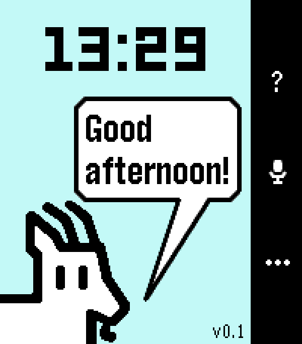

# Mica（云母）

**Your AI. Your keys. Your wrist.**

Bobby 体验 + Billy 的免订阅 + pebble-ai-companion 的多 provider，三合一的 Pebble AI 助手。

面向 **Pebble Time 2（emery）** 与 **Pebble Round 2（gabbro）**。

- **BYOA（Bring Your Own API）**：自带 API key，手机端 PKJS 直连 LLM 厂商，**零自建服务器、零 Rebble 订阅**，key 只存在手机本地
- **OpenAI 兼容任意端点**：OpenAI / DeepSeek / Kimi / Qwen / OpenRouter / 本地 Ollama / LM Studio，只要兼容 `/v1/chat/completions` 即可
- **多 provider**：Google Gemini（含联网搜索 grounding）、OpenAI 兼容、Anthropic Claude，设置页一键切换，key/model/endpoint 分别保存
- **语音输入**：走 Pebble 官方 Dictation API；新 Core 手机 App 在手机本地转写（系统语音识别或本地 Whisper），**语音也免费**
- **Bobby 系完整体验**：闹钟 / 定时器 / Timeline 提醒 / 天气卡片 / 地图卡片 / 澄清选项 / 图片传输 / 个人记忆 / Quick Launch

## 状态

- [x] v0.1 核心：provider 抽象 + 工具调用循环（Node 测试通过）
- [x] emery 构建、PBW 打包、模拟器安装与首次启动/主界面验证
- [ ] emery 真机安装与 DeepSeek 端点实测
- [ ] gabbro 圆屏 UI 适配（当前构建目标暂时只启用 emery）
- [ ] 中文 UI 与提示词优化
- [ ] Android companion 品牌适配（可选，Google 账号工具）

## 构建

首次准备工具链（Python 3.13）：

```bash
uv tool install pebble-tool --python 3.13
pebble sdk install latest
```

构建、测试与安装：

```bash
node test/test_openai_provider.js
node test/test_anthropic_provider.js
node test/test_provider_facade.js
node test/test_nominatim.js

cd app
pebble build                         # 输出 build/app.pbw
pebble install --emulator emery      # 真机使用 --phone <IP>
```

`CMakeLists.clion.txt` 只供 IDE 索引，不是实际构建入口；构建使用 `wscript`。



## 设置

在 Pebble 手机 App 中打开 Mica 设置：

| 设置项 | 说明 |
|---|---|
| AI provider | Gemini / OpenAI-compatible / Claude |
| OpenAI-compatible base URL | 留空 = OpenAI 官方；DeepSeek 填 `https://api.deepseek.com/v1`；Kimi 填 `https://api.moonshot.cn/v1`；Ollama 填 `http://<电脑IP>:11434/v1`（同一 Wi-Fi） |
| 各家 API key / model | 按 provider 分别保存，切换不用重填 |

## 合规与隐私

- [第三方参考项目法律风险审查](docs/LEGAL_REVIEW.md)
- [第三方版权与许可证](THIRD_PARTY_NOTICES.md)
- [隐私政策](PRIVACY.md)

三个参考项目的许可证允许修改与再发布，但公开上架前仍需完成审查文档中的
商业天气 API、美术权属、名称商标和商店隐私检查。完整开源许可证已作为
raw resources 打入 PBW。

## 致谢与许可

Apache 2.0。基于 [Billy](https://github.com/TomBolger/Billy)（Thomas Bolger）fork，
上游为 [Bobby](https://github.com/pebble-dev/bobby-assistant) / Tiny Assistant（Rebble & Pebble 社区，Katharine Berry）。
多 provider 设计参考 [pebble-ai-companion](https://github.com/Toyontaker/pebble-ai-companion)。
原版权与 Apache 2.0 声明保留。
